<picture>
  <source media="(prefers-color-scheme: dark)" srcset="./dark.svg" />
  <source media="(prefers-color-scheme: light)" srcset="./light.svg" />
  
</picture>

 

&nbsp;&nbsp;
&nbsp;&nbsp;
&nbsp;&nbsp;

  

<picture>
  <source media="(prefers-color-scheme: dark)" srcset="https://raw.githubusercontent.com/shaad0650/shaad0650/output/snake-dark.svg" />
  <source media="(prefers-color-scheme: light)" srcset="https://raw.githubusercontent.com/shaad0650/shaad0650/output/snake.svg" />
  
</picture>

